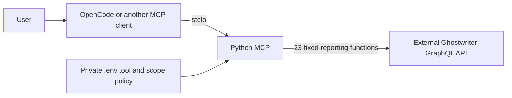

# Allowlisted reporting MCP

The server owns a fixed catalog of 23 typed reporting functions. GW_ENABLED_TOOLS is an optional allowlist and GW_DISABLED_TOOLS is a blacklist; both are JSON arrays of exact names. A nonempty allowlist limits candidates, then the blacklist is subtracted. With both lists missing/empty, all 23 tools are enabled. Registration includes only effective enabled functions; disabled names are absent from discovery and invocation. Unknown names, wildcards and obsolete schema-wide names fail startup. There are no auto-generated API wrappers, arbitrary GraphQL execution tools, subscriptions or policy-changing tools. Changing .env requires restarting the process.

OpenCode's own model writes content. The MCP validates and sends it to Ghostwriter, the only persistent system of record. There is no local reporting database, queue, evidence store, approval service or separate model-provider call. Evidence and exports are handled in memory with configurable size limits.

Authorization combines optional ALLOWED_PROJECTS and ALLOWED_CLIENTS restrictions, upstream token permissions and record ownership checks. Nonempty client/project lists intersect; missing/empty scope lists add no local restriction. Project listings filter both columns, and project authorization reads clientId and rejects an absent or disallowed client when a client list is configured. Existing reports must belong to the selected project. Findings/evidence must belong to the selected report. Template visibility is limited to global and project-client records. The shared finding library remains subject to upstream library permissions. Project, report deletion, account and general administrative functions do not exist in the catalog.

Typed metadata updates permit only title/complete/delivered/archived. Summary and template changes have dedicated tools. No input accepts arbitrary nested record creation or a caller-provided mutation body. Report updates use project/record conditions; mutable content/template updates compare prior values. Summary changes patch one existing/registered narrative JSON key rather than overwriting all report extra fields. Registered fields not yet populated on a fresh report are validated through the read-only getExtraFieldSpec Action and initialized conditionally. Report context exposes field names/types without administrative defaults. Version-specific create defaults are supplied only when the live input schema supports them. Configured GW_SUMMARY_FIELD pins the allowed key.

Finding create/update and summary/template changes mark content incomplete for QA. Metadata updates explicitly permit the report's QA/delivery/archive flags. Permission gates come from the owner's tool selection and Ghostwriter's token, not a local approval workflow. Destructive operations may have upstream cascade semantics; a tool allowlist cannot restrict an agent's independent filesystem/shell access to the token.

Every enabled call validates its GraphQL document and variables against the deployed token schema. Canonical underscore/camelCase differences are adapted only when the live schema supports the alternative. Static upstream snapshots are used for offline tests, never as a runtime permission fallback. Startup, tool discovery, CLI catalog commands and tests make no calls to the configured instance.

Read requests have bounded retries. Mutations are not automatically retried after an uncertain response. Write-outcome errors direct the caller to inspect remote state. Source data, credentials and raw error payloads are not logged. HTTP redirects are disabled. Plain text content is escaped for rich-text fields; model prose still requires factual QA.

The verified generateReport Action returns base64 report JSON and UI document routes. Export tools do not fetch those URLs, render Office documents or maintain local artifact state. Evidence Actions transfer supplied bytes without modifying them; upstream file-type rules apply.

Evidence ownership is resolved from its direct report or its finding. When the report column is nullable, attachment uses exclusive finding ownership; legacy non-null schemas retain report linkage. Evidence deletion prefers the application Action, falling back only on schema unavailability to a scoped delete_evidence mutation. It never falls back after denial or ambiguous transport failure, and does not claim physical-file erasure.
